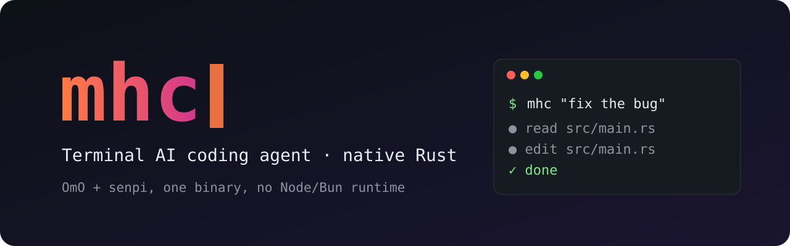
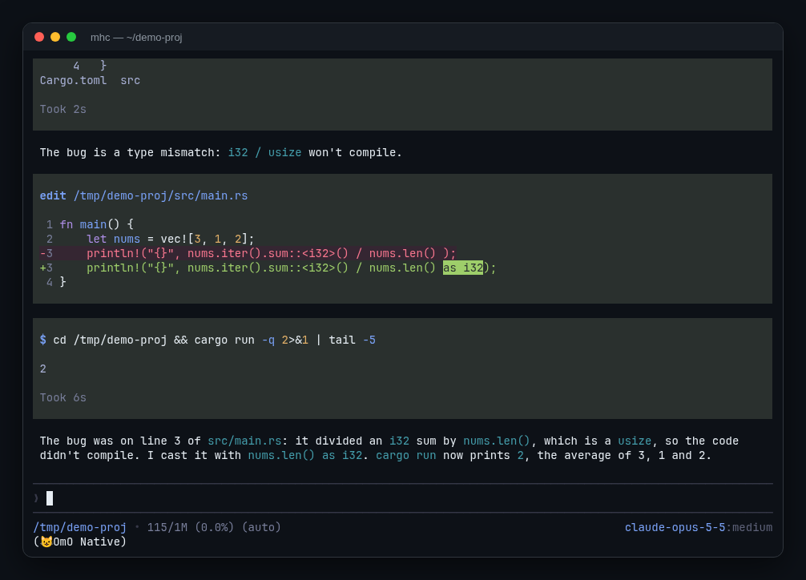

<div align="center">



# mhc

**An AI coding agent for your terminal, built natively in Rust.**

The same kind of tool as Claude Code, Codex CLI and OpenCode: run `mhc` inside a project
and it reads your code, runs commands and edits files to get development work done.

[](#-license)
[](rust-toolchain.toml)
[](#-status)

[简体中文](README.md) · **English**



<sub>A real run: one sentence, and mhc finds the bug, edits the code and verifies it with <code>cargo run</code>.</sub>

</div>

---

## 💡 What is this?

mhc is a **native Rust port** of [senpi](https://github.com/code-yeongyu/senpi) (a terminal AI coding
agent) together with [oh-my-openagent (OmO)](https://github.com/code-yeongyu/oh-my-openagent)
(the feature set that runs on top of it).

In one sentence: **the full OmO-on-senpi experience as a single native program, with no Node/Bun runtime.**

- **Identical behavior** - upstream TypeScript is ported file-for-file, and golden fixtures generated from upstream prove the output matches. It looks, types and behaves like OmO on senpi.
- **Native and self-contained** - one `mhc` executable plus sibling resources (builtin skills, MCP servers); copy the directory and it runs.
- **Extensions are crates** - every extension is a statically registered Rust crate; there is no TypeScript bridge.
- **Easy migration** - bring an existing OmO setup over with `mhc import-omo`.

## 🆚 How it differs from the TypeScript OmO

| | OmO on senpi (TypeScript) | **mhc (Rust)** |
| --- | --- | --- |
| Runtime | Needs Bun / Node | **No runtime at all** |
| Distribution | npm package + dependencies | **One executable + a resource directory** |
| Extensions | TypeScript loaded at runtime | **Rust crates registered at compile time** |
| UI and behavior | - | **Identical to upstream** (checked by golden fixtures) |
| Existing config | - | Migrate with `mhc import-omo` |

## ✨ Features

| Area | What you get |
| --- | --- |
| Interfaces | Full terminal UI (TUI), one-shot `-p` mode, JSON / RPC modes, Codex app-server protocol server |
| Providers | Anthropic, OpenAI, Google Gemini, DeepSeek, Qwen, Kimi / Moonshot, ZAI, MiniMax, Xiaomi MiMo, OpenRouter, Ollama, Amazon Bedrock, Azure OpenAI and more |
| Tools | `read` / `bash` / `edit` / `write` / `grep` / `find` / `ls`, plus web search, web fetch, image generation, LSP, ast-grep and MCP |
| Sessions | Save, continue (`-c`), resume (`-r`), fork (`--fork`), export to HTML (`--export`) |
| OmO | `ultrawork`, `ulw-loop` and `mass-ulw` workflows, subagents (task), long-term memory, comment checker, builtin skills (git-master, debugging, frontend, ...) |
| Customization | Skills, prompt templates, themes, `AGENTS.md` / `CLAUDE.md` project instructions, hooks, permission system |

## 🚀 Install

There are no prebuilt releases yet; build from source. Requirements: Rust 1.95 (selected
automatically by `rust-toolchain.toml`), [Bun](https://bun.sh), and an oh-my-openagent checkout at
the commit in [PINS.md](PINS.md) (used to stage the builtin skills).

```bash
git clone https://github.com/LinKeninDev/mhc.git
cd mhc

# 1. Build every workspace binary (mhc and ast-grep-mcp)
cargo build --workspace --bins --release

# 2. Stage a self-contained directory (OMO_SRC points at the oh-my-openagent checkout)
OMO_SRC=/path/to/oh-my-openagent \
  bun tools/package-native.mjs --binary target/release/mhc --output dist/mhc

# 3. Verify the staged directory
bun tools/package-native.mjs --verify-only dist/mhc
```

Then add `dist/mhc` to your `PATH`.

<details>
<summary>Packaging details</summary>

- The script copies `mhc` and its sibling `ast-grep-mcp`, stages the builtin skills under `skills/`
  and the license texts under `licenses/`, and writes `manifest.json` recording the sha256, size and
  mode of every staged file plus the versions and source pins it was built from.
- `--omo-root` selects the oh-my-openagent checkout (default `$OMO_SRC`); `--ast-grep-mcp` overrides
  the helper binary path; `--force` overwrites an existing non-empty staging directory.
- Resources resolve relative to the executable: skills at `<dir>/skills` (overridable with
  `OMO_SENPI_SKILLS_ROOT`) and the ast-grep MCP server at `<dir>/ast-grep-mcp`. A missing skills
  directory produces a warning and a missing helper skips the ast-grep server, so a directory that
  fails `--verify-only` is not a working install.
- `bun tools/package-native.mjs --self-test` exercises the staging and verification logic against a fixture.

</details>

## ⚡ Quick start

```bash
# Set an API key for any provider
export ANTHROPIC_API_KEY=...        # or OPENAI_API_KEY, DEEPSEEK_API_KEY, GEMINI_API_KEY, ...

cd /path/to/your-project
mhc                                  # interactive TUI
```

Common examples:

```bash
mhc "Explain how this repository is organized"   # start with a prompt
mhc -p "List all .rs files in src/"              # run once and exit
mhc @screenshot.png "What causes this error?"    # attach files
mhc --model sonnet:high                          # pick a model and thinking level
mhc --continue                                   # continue the previous session
mhc --tools read,grep,find,ls -p "Review src/"   # read-only mode
mhc --help                                       # all options
```

Configuration lives in `~/.maho/agent` (override with `MAHO_CODING_AGENT_DIR`). Already using OmO?

```bash
mhc import-omo        # import settings, models, keybindings, auth and sessions from ~/.omo/agent
```

## 🗂 Repository layout

| Path | Contents | Upstream |
| --- | --- | --- |
| `crates/maho-cli` | the `mhc` command-line entry point | senpi |
| `crates/maho-core`, `maho-agent`, `maho-ai` | agent loop, model providers, sessions and config | senpi |
| `crates/maho-tui`, `maho-interactive` | terminal UI components and differential renderer | senpi |
| `crates/maho-rpc`, `maho-server`, `maho-codemode` | RPC / app-server / CodeMode | senpi |
| `crates/builtins/*` | builtin extensions (42) | senpi |
| `crates/extensions/*` | native ports of user extensions (14) | see [PINS.md](PINS.md) |
| `crates/omo/**` | OmO features (workflows, memory, LSP, subagents, desktop control, ...) | oh-my-openagent |
| `tools/` | golden fixture generation, parity audit, packaging | - |

## 🚧 Status

Under active development; parity with upstream is not complete yet. Upstream revisions are pinned in
[PINS.md](PINS.md), and each crate's port mapping is recorded under `parity.d/`.

## 🤝 Contributing

Read [AGENTS.md](AGENTS.md) first. The core rules:

- senpi is the only upstream; port file-for-file, keep names and order, and match the pinned behavior exactly.
- Golden fixtures are generated from upstream by `tools/golden`, never written by hand.
- Tests: `cargo nextest run -p <crate>` (0 skipped) and `cargo clippy -p <crate> --all-targets -- -D warnings`.

## ⭐ Support

If mhc is useful to you, a star is the most direct way to support the project.
Found a problem or have an idea? Open an [issue](https://github.com/LinKeninDev/mhc/issues).

## 📄 License

This repository is **mixed-licensed**: each part keeps the license of the upstream project it ports.

- `crates/maho-*`, `crates/builtins`, `crates/extensions` and `crates/vendor` port
  [senpi](https://github.com/code-yeongyu/senpi) and are licensed **MIT** - see [LICENSES/MIT.txt](LICENSES/MIT.txt).
- `crates/omo/**` ports [oh-my-openagent](https://github.com/code-yeongyu/oh-my-openagent)
  and is licensed under the **Sustainable Use License 1.0** - see [LICENSES/SUL-1.0.md](LICENSES/SUL-1.0.md).
  It permits free, non-commercial use, modification and redistribution; commercial use and paid
  distribution are not permitted.

This software is a modified derivative of both upstream projects (a Rust reimplementation of their
TypeScript sources), which the Sustainable Use License requires to be stated.
